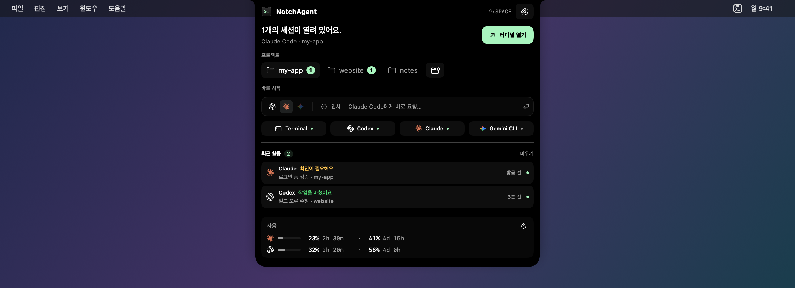
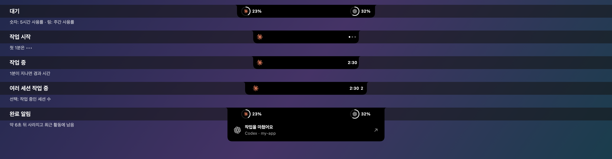
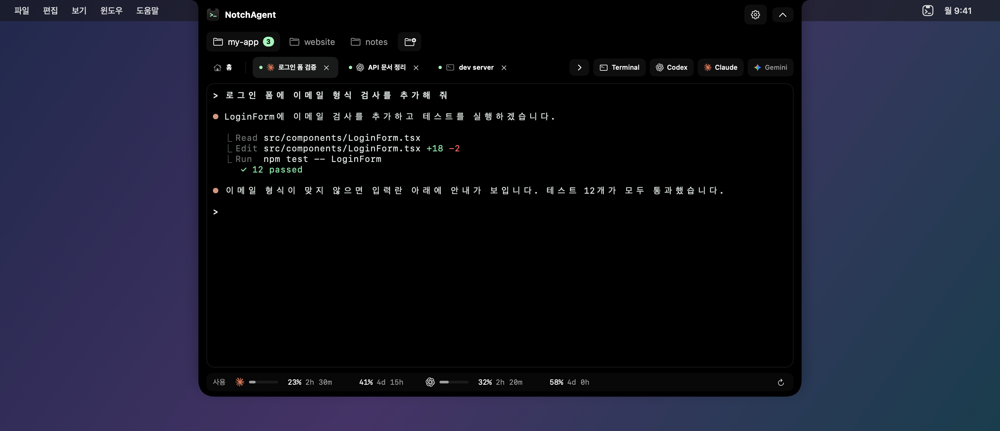
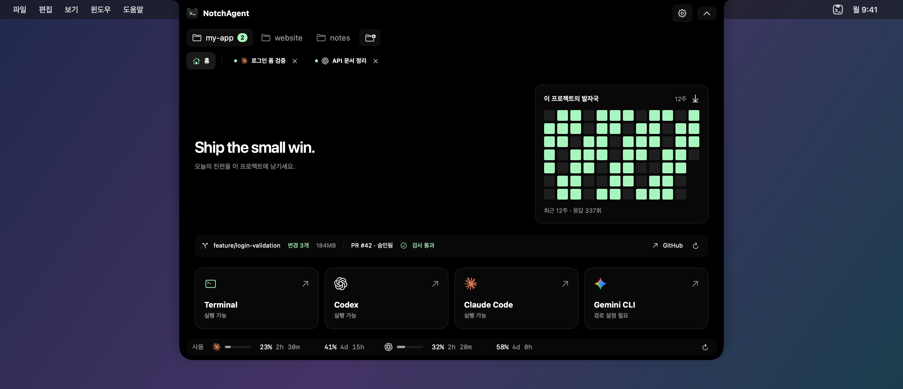

# NotchAgent

[English](README.md) · **한국어**

**맥북 노치에서 바로 여는 터미널. Codex·Claude Code·Gemini CLI를 가까이 두고 작업하세요.**

프로젝트를 고르고 에이전트를 시작한 뒤, 노치를 접어 화면을 돌려받으세요. 세션은 직접 끝내거나 앱을 종료하기 전까지 계속 실행됩니다. 평소 설치하고 로그인해 둔 CLI와 그 설정을 사용합니다.



*샘플 데이터를 사용한 앱 화면입니다.*

## 처음 시작하기

**Apple Silicon Mac과 macOS 14 이상**이 필요합니다. 사용할 CLI를 먼저 설치하고 로그인해 주세요. Codex는 `codex`, Claude Code는 `claude`, Gemini CLI는 `gemini` 명령을 사용합니다. 에이전트 없이 터미널만 사용해도 됩니다.

1. [Releases](https://github.com/2betforyou/NotchAgent/releases)에서 DMG 또는 ZIP을 받습니다.
2. **NotchAgent.app**을 **응용 프로그램** 폴더로 옮겨 실행합니다.
3. 노치를 클릭하거나 **Control + Option + Space**(`⌃⌥Space`)를 누릅니다.
4. 폴더 추가 버튼으로 프로젝트를 등록하고 **Terminal·Codex·Claude·Gemini** 중 하나를 선택합니다.

Dock 아이콘은 없습니다. 다시 열 때는 노치나 메뉴바 아이콘을 사용하세요.

공증되지 않은 빌드는 macOS가 처음 실행을 막을 수 있습니다. 앱을 한 번 연 뒤 **시스템 설정 → 개인정보 보호 및 보안 → 그래도 열기**를 확인하세요. 서명·공증 여부는 해당 릴리스 노트에서 확인할 수 있습니다.

에이전트 버튼을 사용할 수 없다면 **설정 → 에이전트 → CLI 실행 파일**에서 경로를 확인하세요. CLI 설치와 로그인은 각 CLI에서 진행합니다.

## 세 가지 화면

| 화면 | 할 수 있는 일 |
|---|---|
| 최소화 | 작업 상태와 사용한 비율을 한눈에 확인 |
| 미리보기 — 노치에 마우스 올리기 | 프로젝트 선택, 바로 요청, 사용량 확인, 놓친 알림 확인 |
| 작업 화면 — 클릭 또는 단축키 | 터미널 사용, 세션 전환, 프로젝트 홈 열기 |

### 작업할 때만 눈에 띄는 노치

에이전트가 작업 중이면 아이콘과 움직이는 점을 표시하고, 1분 뒤부터 경과 시간을 보여 줍니다. 작업 중인 세션이 없으면 사용량으로 돌아갑니다. 확인하지 않은 완료·확인 요청이 남아 있어도 사용량 표시를 계속 차지하지 않습니다.

사용량의 **숫자는 5시간 한도**, **아이콘 둘레의 링은 주간 한도**에서 사용한 비율입니다. 미리보기·작업 화면과 동일하게 0%에서 100%로 늘어납니다. CLI가 한 종류의 한도만 보내면 둘 다 그 값을 사용합니다. **설정 → 에이전트**에서 사용량을 켜고, 조회된 값이 있어야 표시됩니다.

**설정 → 노치 → 최소화 화면**에서 상시 표시를 선택하세요.

| 표시 | 기본값 |
|---|---|
| 쉬는 동안 사용량 | 켜짐 |
| 작업 중 표시 | 켜짐 |
| 작업 중인 개수 | 꺼짐 |



완료·확인 요청 알림은 약 6초 뒤 사라지며, **최근 활동**에서 다시 확인할 수 있습니다. **설정 → 알림 → 이벤트별 알림**에서 완료·확인 요청·세션 종료마다 **노치·알림 센터·소리**를 따로 고를 수 있습니다. 기존 알림 선택은 유지되며 별도의 전체 스위치를 함께 켤 필요가 없습니다. 표시를 꺼도 세션은 계속 실행됩니다.

### 프로젝트와 세션

미리보기와 작업 화면에 프로젝트 목록이 기본으로 표시됩니다. 폴더를 추가하거나 선택해 전환하고, 끌어서 순서를 바꾸세요. 프로젝트를 우클릭하면 새 세션 열기, Finder에서 보기, 프로젝트 관리 메뉴가 나옵니다.

- 모든 프로젝트를 합쳐 **최대 8개의 세션 탭**을 열 수 있습니다.
- 탭에는 CLI가 알려 주는 작업 제목이 나옵니다. 더블클릭하면 직접 이름을 정할 수 있습니다.
- 탭을 끌어 순서를 바꿀 수 있으며 **홈** 탭은 프로젝트의 맨 왼쪽에 남습니다.
- 저장소 메뉴에서 **git worktree**를 만들면 별도 브랜치와 폴더에서 작업할 수 있습니다. 커밋하지 않은 변경을 잃게 되는 제거는 차단합니다.
- 미리보기에서 에이전트를 고르고 **바로 요청**을 보내면 현재 프로젝트에 세션이 열립니다. 시작하지 못하면 작성한 요청을 그대로 남깁니다.



*샘플 데이터를 사용한 앱 화면입니다.*

### 홈의 저장소 상태



*샘플 데이터를 사용한 앱 화면입니다.*

잔디와 시작 카드 사이에 현재 브랜치와 변경 파일 수가 표시됩니다. 변경 수를 누르면 파일 목록을 볼 수 있습니다. GitHub 프로젝트에서는 저장소 열기와 **PR·검사 연결**도 표시합니다. 이 선택 기능은 설치된 GitHub CLI(`gh`)의 기존 로그인을 사용하며 설정 → 에이전트에서 끌 수 있습니다. 현재 브랜치의 열린 PR·초안/리뷰 상태·검사를 읽고, PR이 없으면 로컬 HEAD 커밋의 최신 워크플로 실행을 확인합니다. 조회 실패와 PR 없음을 구분합니다. 홈을 보고 있을 때 1분마다, 또는 새로고침 버튼을 누르면 갱신됩니다. `origin`의 github.com 저장소만 지원하며 저장소 변경이나 로그인 절차는 실행하지 않습니다. Git 폴더가 아니면 상태 줄을 숨기고, 창과 기존 요소 크기는 유지하며 시작 카드를 상태 줄 아래에 배치합니다.

저장소 상태 줄에는 **로컬 디스크 사용량**도 표시합니다. `.git`·의존성·빌드 결과물을 포함하며 외부 심볼릭 링크 대상은 따라가지 않습니다. 5분간 캐시하고, 용량을 누르면 상세 확인·재계산이 가능합니다. `—`는 계산 중이거나 읽을 수 없다는 뜻이지 0바이트가 아닙니다.

### 임시 채팅

미리보기의 **바로 시작** 입력줄에서 **임시**를 켜고 요청을 보내세요. 선택한 프로젝트와 분리된 임시 폴더에서 실행되며 프로젝트 목록에 등록되지 않습니다. 앱을 사용하는 동안 **임시 채팅** 칩으로 돌아올 수 있고, 그곳의 시작 카드도 새 임시 세션을 엽니다.

NotchAgent의 세션 복원·최근 활동 보관·프로젝트 잔디에는 포함하지 않습니다. **시크릿 모드나 샌드박스는 아닙니다.** CLI 자체 대화 기록은 남을 수 있고 파일 접근 권한도 기존과 같습니다. 생성된 파일은 macOS 임시 폴더(`NotchAgent-Chats`)에 남으며 사용자 또는 macOS가 정리합니다. 중요한 파일은 종료 전에 다른 곳에 저장하세요.

### 파일 전달과 터미널 조작

파일이나 이미지를 **터미널 안에** 놓으면 경로가 입력됩니다. 내용을 확인한 뒤 Return을 눌러 제출하세요. 폴더를 **노치나 프로젝트 영역에** 놓으면 프로젝트로 등록하고 전환합니다. 터미널 안에 놓으면 폴더 경로만 입력합니다.

터미널은 컬러 출력, 한글 조합 입력, 5,000줄 스크롤백, 검색, 링크 열기를 지원합니다. 기본 테마의 배경은 완전한 검정입니다. 앱을 실행한 환경에 색상 끄기 옵션이 있더라도 내부 CLI의 컬러 출력은 유지하도록 처리합니다.

| 동작 | 방법 |
|---|---|
| 열기 / 접기 | `⌃⌥Space`, 노치 클릭, 메뉴바 아이콘 |
| 프로젝트 홈 | `⌘1` |
| 세션 탭 선택 | `⌘2`–`⌘9` |
| 다음 / 이전 탭 | `⇧⌘]` / `⇧⌘[` |
| 현재와 같은 종류의 새 세션 | `⌘T` |
| 확인 필요한 세션으로 이동 | `⇧⌘A` |
| 터미널 검색 | `⌘F`, 다음 `⌘G`, 이전 `⇧⌘G` |
| 링크 열기 | `⌘`를 누른 채 URL 클릭 |
| 탭 이름 변경 | 더블클릭 또는 우클릭 → 이름 변경 |
| 세션 종료 | 탭의 `×` 또는 셸에서 `exit` |

`Esc`, `⌃C`, `⌘W`는 CLI로 전달됩니다. 앱을 접을 때는 전역 단축키를 사용하세요. 단축키, 마우스 반응, 표시 화면, 작업 화면 크기는 설정에서 바꿀 수 있습니다. 크기는 작게·기본·크게 중 선택하며 실제 화면에 맞게 제한됩니다.

### 자리를 비운 동안의 활동 확인

**최근 활동**에 작업 완료, 확인 요청, 세션 종료가 모입니다. 열린 세션은 눌러 돌아갈 수 있습니다. 닫힌 Codex·Claude 세션의 **이어가기**를 누르면 원래 프로젝트에서 같은 대화를 엽니다. 앱 재실행 후에도 사용할 수 있고, 이미 열린 대화는 해당 탭으로 이동합니다. 프로젝트 경로·대화 ID가 없는 예전 기록은 복원할 수 없는 이유를 안내하며 다른 대화를 임의로 열지 않습니다.

최대 50개를 기기에 24시간 보관합니다. **설정 → 알림**에서 보관을 끄거나, macOS 알림 센터와 소리로 받을 이벤트를 고를 수 있습니다. 알림 센터와 소리는 기본 꺼짐이며, 작업 제목·폴더를 시스템 알림에 포함할지도 선택할 수 있습니다.

Claude 훅과 Codex 완료 알림으로 이벤트를 받습니다. 시작 신호를 받지 못하는 CLI의 작업 상태 등은 출력 흐름으로 추정하므로 실제 상태와 차이가 날 수 있습니다.

### 이 프로젝트의 발자국

홈에는 **최근 12주 동안 해당 프로젝트에서 끝난 에이전트 응답 수**를 잔디로 보여 줍니다. 열린 세션 수나 사용 토큰 수가 아닙니다. 홈 문구는 시간대와 날짜에 따라 달라집니다.

홈의 **과거 대화 가져오기** 또는 **설정 → 에이전트**에서 현재 프로젝트의 Codex·Claude 로컬 기록을 가져올 수 있습니다. 날짜별 횟수의 추정치이며, 반복해서 가져와도 같은 기록을 중복 합산하지 않습니다. Gemini 과거 기록은 지원하지 않습니다.

프로젝트 경로와 날짜별 횟수만 최대 1년 보관합니다. 기록을 끄면 저장한 횟수도 삭제됩니다. 활동 가져오기는 대화를 다시 열거나 본문을 앱에 복사하는 기능이 아닙니다.

## 사용량은 어떻게 갱신되나요?

**설정 → 에이전트**에서 사용할 에이전트의 사용량을 켜세요. 표시하는 값은 **계정 전체의 남은 한도**이며, 현재 프로젝트에서 쓴 토큰 수가 아닙니다.

| 에이전트 | 갱신 방식 |
|---|---|
| Codex | 로컬 CLI에서 5분마다 조회. 직접 새로고침도 가능 |
| Claude Code | NotchAgent에서 연 Claude 세션의 응답 시 갱신. 새로고침은 마지막 값을 다시 읽음 |
| Gemini CLI | 세션 실행 지원. 계정 사용량 표시는 미지원 |

세 화면 모두 **사용한 비율**이 0%에서 100%로 늘어나며 Claude, Codex 순서로 표시합니다. 작업 화면 맨 아래는 **사용**, 에이전트 아이콘, 작은 막대, 사용 비율, 초기화까지 남은 시간을 한 줄로 표시하고, 미리보기는 같은 표시를 에이전트별 한 줄씩 배치합니다. 아이콘을 누르면 갱신 상세를 볼 수 있고, 오래된 값·조회 오류는 작은 주황 점으로 알립니다. 갱신 시각 문구는 사용량 줄에 따로 표시하지 않습니다.

갱신 시각은 사용량 아이콘을 눌렀을 때와 에이전트 설정에서 확인합니다. 오래된 값이나 조회 실패는 주황색 점으로 구분하며, 아이콘을 누르면 정확한 시각·실패 이유·재시도를 확인할 수 있습니다. Codex는 10분, Claude는 1시간이 지나거나 한도 초기화 시각이 지나면 오래된 값으로 표시합니다. Claude의 재시도는 새 한도를 조회하는 대신 마지막 로컬 값을 다시 읽습니다.

값이 없다고 남은 사용량이 0이라는 뜻은 아닙니다. Claude 값은 다음 응답 전까지 오래된 값일 수 있습니다. NotchAgent에 별도 계정을 만들거나 API 키를 입력할 필요는 없습니다. 인증은 각 CLI가 관리합니다.

## 접기, 종료, 다시 이어가기

**접으면 작업이 계속되고, 앱을 종료하면 열린 터미널과 에이전트도 종료됩니다.**

앱 종료는 **설정 → 정보 → 앱 종료** 또는 **메뉴바 아이콘 → NotchAgent 종료**를 사용하세요. 실행 중인 에이전트나 명령을 수행 중인 셸을 닫을 때 확인을 요청합니다.

**설정 → 에이전트 → 다시 열 때 세션 복원**을 켜면 탭이 돌아오고, 탭을 열 때 실행합니다. Codex·Claude는 저장된 대화 ID가 있으면 그 대화를 이어갑니다. ID가 없으면 프로젝트의 마지막 대화로 이어질 수 있습니다. 셸은 새로 시작합니다. **미제출 입력, 터미널 스크롤 기록, 실행 중이던 프로세스는 복원되지 않습니다.**

## 설정 위치

설정은 별도 창 대신 펼쳐진 노치 안에서 열립니다. 작업 화면과 같은 검정 배경·강조색을 사용하며, 상단 **작업으로 돌아가기**를 누르면 보던 탭으로 돌아갑니다. 설정을 보는 동안에도 세션은 실행되고, 접었다 다시 열어도 설정 화면을 유지합니다.

| 페이지 | 바꿀 수 있는 항목 |
|---|---|
| 일반 | 언어, 전역 단축키, 로그인 시 실행 |
| 노치 | 표시 화면, 마우스 반응, 자동 접기, 크기, 최소화 화면 표시 |
| 알림 | 이벤트별 노치·알림 센터·소리, 알림 개인정보, 최근 활동 보관 |
| 모양 | 강조색, 터미널 테마, 글꼴, 글자 크기 |
| 에이전트 | CLI 경로, 세션 복원, 사용량, 프로젝트 활동과 과거 기록 가져오기 |
| 정보 | 버전, 앱 종료 |

## 개인정보

NotchAgent는 분석 서버나 텔레메트리를 사용하지 않으며, 터미널 본문을 기록하지 않습니다. 설정, 프로젝트 경로, 세션 복원 정보, 선택적으로 보관하는 최근 활동과 응답 횟수는 Mac에 저장합니다.

실행한 CLI는 사용자의 권한과 자체 설정에 따라 파일에 접근하고 네트워크를 사용합니다. 대화 기록은 각 CLI가 관리합니다. 파일 경로가 없는 이미지를 끌어놓으면 CLI가 접근할 수 있도록 임시 폴더에 저장합니다.

손쉬운 사용·화면 기록 권한은 요구하지 않습니다. 알림 센터 권한은 해당 기능을 켤 때 요청합니다. 자세한 내용은 [개인정보 안내](PRIVACY.md)와 [제3자 고지](THIRD-PARTY-NOTICES.md)를 참고하세요.

## 도움이 필요할 때

| 증상 | 확인할 곳 |
|---|---|
| Dock에 안 보여요 | 정상입니다. 노치나 메뉴바 아이콘으로 여세요 |
| 에이전트 버튼을 못 눌러요 | CLI 설치·로그인과 설정 → 에이전트 → 실행 파일 경로 확인 |
| 사용량이 안 보여요 | 설정 → 에이전트에서 켜기. Claude는 앱에서 연 세션의 응답이 필요 |
| 노치 알림이 안 보여요 | 설정 → 알림 → 이벤트별 알림에서 해당 이벤트의 노치 표시 확인 |
| 실제 노치에 안 붙어요 | 내장 화면을 켜고 내장 노치 화면 우선 선택 |
| 다른 노치 앱과 겹쳐요 | 다른 노치 앱을 잠시 종료 |
| 단축키가 안 먹어요 | 노치나 메뉴바로 열고 설정에서 단축키 변경 |

버그는 [GitHub Issues](https://github.com/2betforyou/NotchAgent/issues)에 macOS·앱·CLI 버전과 재현 순서를 함께 남겨 주세요. 그 밖의 문의: june295921@gmail.com.

<details>
<summary>개발자를 위한 빌드·테스트·배포</summary>

macOS 개발 도구가 포함된 Xcode가 필요합니다. 의존성은 저장소에 포함되어 있습니다.

```sh
git clone https://github.com/2betforyou/NotchAgent.git
cd NotchAgent
bash Scripts/build.sh
bash Scripts/test.sh
bash Scripts/package.sh
```

또는 `NotchAgent.xcodeproj`를 열고 **NotchAgent → My Mac → Run**을 실행하세요. 라이선스 동의나 초기 설정을 요청하면 Xcode에서 먼저 완료해 주세요.

빌드 결과는 기본적으로 `/private/tmp/NotchAgent-build-<uid>`에 생성됩니다. `NOTCHAGENT_BUILD_DIR`로 변경할 수 있습니다. 패키징은 실행 중인 앱을 교체하지 않고 `Dist/`에 버전별 ZIP과 SHA-256 체크섬을 만듭니다. 배포·서명·공증은 [v0.1.2 업로드 가이드](docs/releases/v0.1.2-upload.md)를 참고하세요.

```text
Sources/    앱과 터미널 연동
Tests/      단위·PTY 통합·UI 렌더링 테스트
Scripts/    빌드·테스트·이미지·패키징·배포
Resources/  앱 메타데이터·아이콘·라이선스
Vendor/     저장소에 포함된 SwiftTerm
```

터미널은 [SwiftTerm](https://github.com/migueldeicaza/SwiftTerm)을 사용합니다. Codex는 일반 스크롤백을 쓰는 인라인 모드(`--no-alt-screen`)로 실행합니다. 앱 오류 로그는 아래 명령으로 확인할 수 있습니다.

```sh
log show --last 1h --info --predicate 'subsystem == "app.notchagent.desktop"'
```

로그를 공유하기 전 내용을 확인해 주세요.

</details>

## 라이선스

NotchAgent의 라이선스는 아직 정해지지 않았습니다. 포함된 의존성의 라이선스는 [THIRD-PARTY-NOTICES.md](THIRD-PARTY-NOTICES.md)를 참고하세요. 에이전트 이름은 외부 프로그램을 식별하기 위한 것이며 제휴나 보증을 의미하지 않습니다.
