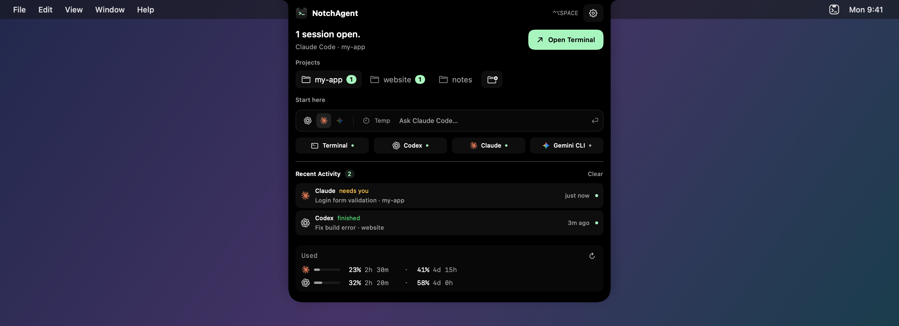
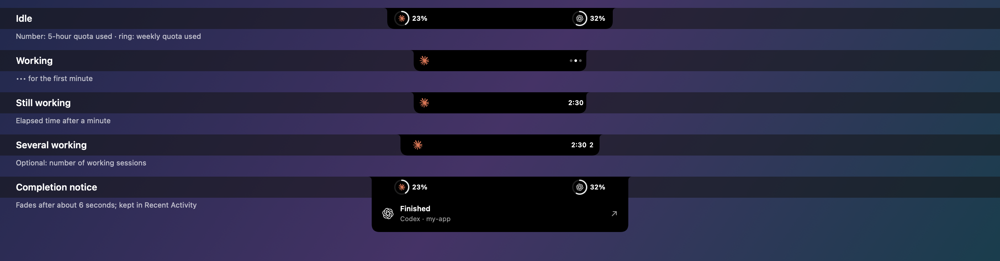
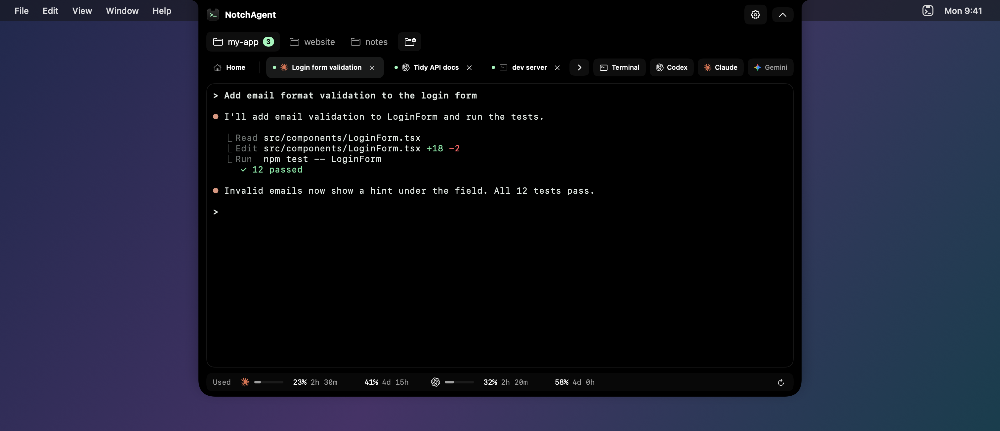
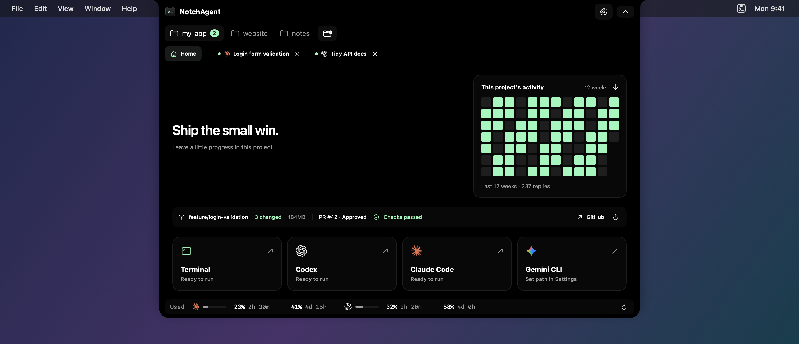

# NotchAgent

**English** · [한국어](README.ko.md)

A terminal for your MacBook's notch. Keep Codex, Claude Code, and Gemini CLI close while you work.

Open your project, start an agent, and collapse the notch to get your screen back. Your sessions keep running until you end them or quit the app. NotchAgent uses the CLIs you already have installed and signed in.



*Illustrative app UI with sample data.*

## Get started

You need an **Apple silicon Mac with macOS 14 or later**. Install and sign in to whichever CLI you want to use: Codex (`codex`), Claude Code (`claude`), or Gemini CLI (`gemini`). You can also use the terminal on its own.

1. Download a DMG or ZIP from [Releases](https://github.com/2betforyou/NotchAgent/releases).
2. Move **NotchAgent.app** into **Applications** and open it.
3. Click the notch or press **Control + Option + Space** (`⌃⌥Space`).
4. Add a project folder with the folder-plus button, then choose **Terminal**, **Codex**, **Claude**, or **Gemini**.

There is no Dock icon. Use the notch or the menu bar icon to open the app again.

If macOS blocks an unnotarized build, open it once, then go to **System Settings → Privacy & Security → Open Anyway**. Check the release notes for that build's signing and notarization status.

If an agent is unavailable, open **Settings → Agents** and check its executable path. NotchAgent doesn't install CLIs or sign you in.

## Three ways to use the notch

| View | What you can do |
|---|---|
| Collapsed | Glance at ongoing work or consumed quota without opening a window |
| Preview — hover over the notch | Switch projects, send a quick request, check usage, and catch up on recent activity |
| Workspace — click or use the shortcut | Use the terminal, switch session tabs, or visit your project's Home |

### A quiet notch while you work

While an agent is working, the notch shows its icon and working dots. After a minute, it shows elapsed time. When no sessions are working, it returns to available usage readings—even if an unseen completion or input request remains.

The **number is 5-hour quota used** and the **ring is weekly quota used**. Both grow from 0% to 100%, just like the preview and workspace. If the CLI reports only one window, both use that window. Usage must be enabled in **Settings → Agents**, and a reading must be available.

In **Settings → Notch → Collapsed notch**, choose the persistent displays:

| Option | Default |
|---|---|
| Usage while idle | On |
| Ongoing work | On |
| Number of working sessions | Off |



Completion and input request notices disappear after about six seconds. Find them again in **Recent Activity**. Choose **Notch**, **Notification Center**, and **Sound** separately for each event in **Settings → Alerts → Event delivery**. Existing delivery choices are preserved; there is no separate notice master switch. Turning off notch displays doesn't stop your sessions.

### Projects and sessions

Projects are always visible in the preview and workspace. Add a folder, switch projects, or drag the folder chips to reorder them. Right-click a project to start a session, reveal it in Finder, or manage it.

- Keep up to **8 session tabs across all projects**.
- Tabs use the task title reported by the CLI. Double-click a tab to rename it.
- Drag tabs to reorder them. The **Home** tab stays at the far left of each project.
- Create a **git worktree** from a repository's context menu to work on a separate branch and checkout. Removal is blocked when it would discard uncommitted changes.
- In the preview, select an agent and send a **quick request**. It opens a session in the selected project. If launch fails, your draft stays in the input.



*Illustrative app UI with sample data.*

### Repository status on Home



*Illustrative app UI with sample data.*

Between the activity heatmap and launch cards, Git projects show the current branch and changed-file count. Click the count to inspect file names. GitHub projects also have a repository link and **Connect PR & checks**. This optional connection uses the installed GitHub CLI (`gh`) and its existing sign-in; you can disable it in Settings → Agents. It reads the branch's open PR, review/draft state, and checks. Without a PR, it can show the latest workflow run for the local HEAD commit. Failures remain distinct from “no PR.” Data refreshes every minute while Home is open or with the row's refresh button. Only github.com remotes on `origin` are supported; no repository writes or sign-in flow are performed. Non-Git folders hide the row. Home keeps its fixed window size and existing element sizes; the launch cards sit below the repository row.

The repository row also shows **local disk usage**, including `.git`, dependencies, and build output. External symlink targets are not followed. Size is cached for five minutes; click it for details or recalculate manually. A dash means it is still calculating or unavailable, not zero bytes.

### Temporary chats

In the preview's **Start here** input, turn on **Temp** before submitting. The agent starts in its own temporary folder, without using or registering your selected project. A **Temporary chats** chip lets you switch back while the app stays open; launch cards there also create temporary sessions.

NotchAgent excludes these sessions from session restoration, saved recent activity, and project activity counts. This is **not incognito mode or a sandbox**: the CLI can keep its own conversation history and has its normal file permissions. Generated files remain in the macOS temporary directory (`NotchAgent-Chats`) until removed by you or macOS. Save anything important elsewhere before quitting.

### Files, terminal, and keyboard

Drop a file or image **inside the terminal** to insert its path. Review it and press Return yourself. Drop a folder **on the notch or project area** to add and switch projects; dropping it inside the terminal inserts its path instead.

The terminal supports color output, Korean input composition, 5,000 lines of scrollback, search, and clickable links. The default theme uses a pure black background. CLI color output is preserved even when the app's launcher disables color in its own environment.

| Action | Shortcut or control |
|---|---|
| Open / collapse | `⌃⌥Space`, notch click, or menu bar icon |
| Project Home | `⌘1` |
| Session tabs | `⌘2`–`⌘9` |
| Next / previous tab | `⇧⌘]` / `⇧⌘[` |
| New session of the current kind | `⌘T` |
| Session needing attention | `⇧⌘A` |
| Find in terminal | `⌘F`; next `⌘G`, previous `⇧⌘G` |
| Open a URL | `⌘`-click |
| Rename a tab | Double-click, or right-click → Rename |
| End a session | Tab's `×`, or `exit` in the shell |

`Esc`, `⌃C`, and `⌘W` go to the CLI. Use the global shortcut to collapse the app. You can change the shortcut, hover behavior, display preference, and workspace size in Settings. Sizes are Small, Default, and Large, constrained to your screen.

### Catch up without watching the terminal

**Recent Activity** collects completions, requests for input, and session endings. Click to return to an open session. When a Codex or Claude session has closed, **Resume** opens its saved conversation in the original project, including after an app relaunch. If that conversation is already open, its tab is selected instead. Older events without a project path and conversation ID can't be resumed; the app explains why instead of opening a different conversation.

Up to 50 events are kept locally for 24 hours. In **Settings → Alerts**, you can disable retention, choose macOS notification and sound events, and opt into showing task titles and folders in system notifications. Notification Center and sounds are off by default.

Claude hooks and Codex completion notifications provide event signals. Other activity, including working status where start signals aren't available, is inferred from terminal output and can be approximate.

### Your project's activity

Home shows a **12-week heatmap of completed agent replies in that project**. It counts replies, not open sessions or tokens. Home's greeting changes with the time of day and date.

Use **Import past conversations** on Home or in **Settings → Agents** to add estimates from local Codex and Claude history for the selected project. Importing again doesn't add the same history twice. Past Gemini history isn't imported.

Only daily counts and project paths are saved, for up to a year. Turning project activity recording off deletes the saved counts. Importing activity doesn't reopen conversations or copy their text into NotchAgent.

## Usage readings

Enable the agents you want in **Settings → Agents**. These are **account-level limits**, not the tokens spent in the selected project.

| Agent | How readings update |
|---|---|
| Codex | Queries the local CLI's account limits every five minutes; you can refresh manually |
| Claude Code | Updates from limit values reported when a Claude session opened in NotchAgent replies; refresh re-reads the latest value |
| Gemini CLI | Session launching is supported; account quota display isn't available |

All three sizes show **used quota**, growing from 0% to 100%; Claude comes before Codex. The workspace footer is a single line: **Used**, agent icons, a small usage bar, consumed percentages, and time until reset. The preview uses the same compact display, one row per agent. Click an agent icon for update details; an orange dot indicates an outdated or failed reading.

Update times are kept in agent-icon popovers and Agents settings, not the compact usage rows. Click the icon for the exact update time, failure details, and retry. Codex readings become outdated after ten minutes; Claude readings after an hour, or earlier if a reported limit has reset. Retrying Claude re-reads the last local value rather than fetching a fresh limit.

A missing reading isn't zero remaining quota. Claude's value may be old until the next reply. NotchAgent doesn't have a separate account or API-key entry screen; each CLI manages its own authentication.

## Collapse, quit, and come back

**Collapsing keeps work running. Quitting ends open terminal and agent processes.**

To quit, use **Settings → About → Quit App** or **menu bar icon → Quit NotchAgent**. The app asks before closing running agents or busy shells.

With **Settings → Agents → Restore sessions on relaunch** enabled, tabs return and start when opened. Codex and Claude use a saved conversation ID when available; without one, restoration may fall back to the project's latest conversation. Shell tabs start a new shell. Unsubmitted input, terminal scrollback, and running processes aren't restored.

## Settings at a glance

Settings open inside the expanded notch, using the same black background and accent as your workspace. Use **Back to workspace** to return to your selected tab. Sessions keep running while you change settings; collapsing and reopening keeps settings open.

| Page | Controls |
|---|---|
| General | Language, global shortcut, launch at login |
| Notch | Display, hover, auto-collapse, workspace size, collapsed displays |
| Alerts | Event-by-event notch, Notification Center, and sound delivery; notification privacy; recent activity retention |
| Appearance | Accent, terminal theme, font, font size |
| Agents | CLI paths, session restoration, usage, project activity and history import |
| About | Version and Quit App |

## Privacy

NotchAgent has no analytics service or telemetry. It doesn't save terminal transcripts. Settings, project paths, session restore metadata, optional recent activity, and project reply counts stay on your Mac.

Running CLIs can read files and use the network with your user permissions and their own settings. Their conversation histories remain managed by those CLIs. Pasted image drops without an existing file path are saved in a temporary folder so the CLI can access them.

NotchAgent doesn't request Accessibility or Screen Recording permission. macOS notification permission is requested only if you enable Notification Center. See [Privacy details](PRIVACY.md#english) and [third-party notices](THIRD-PARTY-NOTICES.md).

## Help

| Problem | What to check |
|---|---|
| No Dock icon | Use the notch or menu bar icon; this is expected |
| Agent button unavailable | Install/sign in to its CLI and check Settings → Agents → CLI executables |
| Usage not showing | Enable that agent's usage in Settings → Agents; Claude needs a reply from a session opened in NotchAgent |
| Notch notices not showing | Enable Notch for that event in Settings → Alerts → Event delivery |
| Not attached to the camera notch | Enable the built-in display and select Built-in notch display first |
| Another notch app overlaps | Temporarily quit the other notch app |
| Shortcut conflict | Open from the notch or menu bar and change the shortcut in Settings |

Report bugs in [GitHub Issues](https://github.com/2betforyou/NotchAgent/issues), including macOS/app/CLI versions and steps to reproduce. Other inquiries: june295921@gmail.com.

<details>
<summary>Build, test, and package from source</summary>

Use a full Xcode installation with macOS development tools. Dependencies are vendored.

```sh
git clone https://github.com/2betforyou/NotchAgent.git
cd NotchAgent
bash Scripts/build.sh
bash Scripts/test.sh
bash Scripts/package.sh
```

You can also open `NotchAgent.xcodeproj`, choose **NotchAgent → My Mac**, and Run. If Xcode requests a license agreement or first-launch setup, complete that in Xcode first.

Build products use `/private/tmp/NotchAgent-build-<uid>` by default; override with `NOTCHAGENT_BUILD_DIR`. Packaging creates a versioned ZIP and SHA-256 checksum in `Dist/` without replacing a running app. See the [v0.1.2 upload guide](docs/releases/v0.1.2-upload.md) for release preparation, signing, and notarization.

```text
Sources/    App and terminal integration
Tests/      Unit, PTY integration, and UI rendering tests
Scripts/    Build, test, images, packaging, and release
Resources/  App metadata, icons, and licenses
Vendor/     Bundled SwiftTerm
```

The terminal uses [SwiftTerm](https://github.com/migueldeicaza/SwiftTerm). Codex launches in inline mode (`--no-alt-screen`) for normal scrollback. To collect app error logs:

```sh
log show --last 1h --info --predicate 'subsystem == "app.notchagent.desktop"'
```

Review logs before sharing them.

</details>

## License

NotchAgent's license hasn't been decided yet. Bundled dependencies have their own licenses; see [THIRD-PARTY-NOTICES.md](THIRD-PARTY-NOTICES.md). Agent names identify external programs and don't imply affiliation or endorsement.
